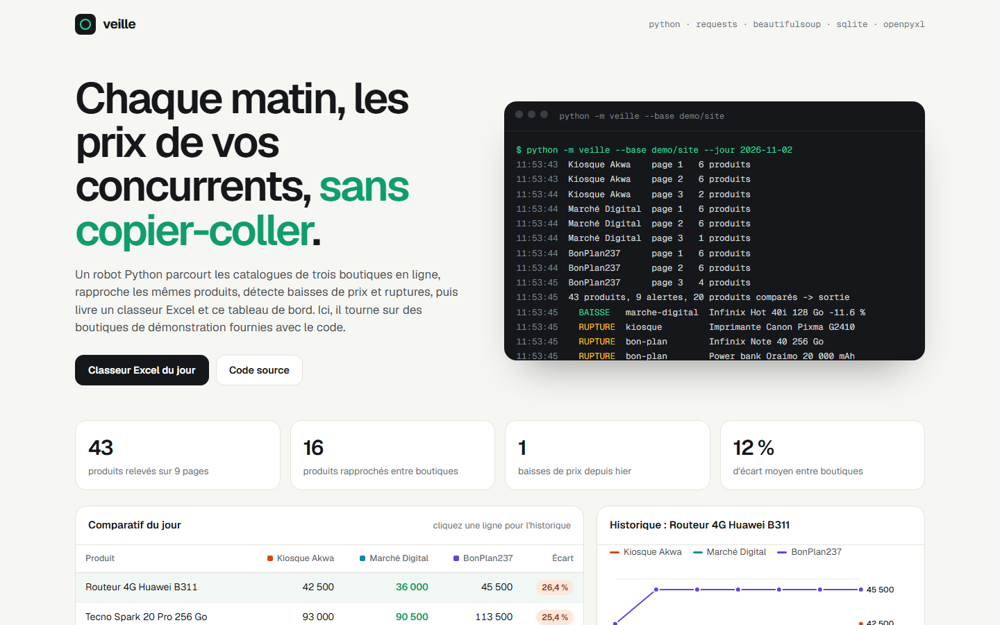
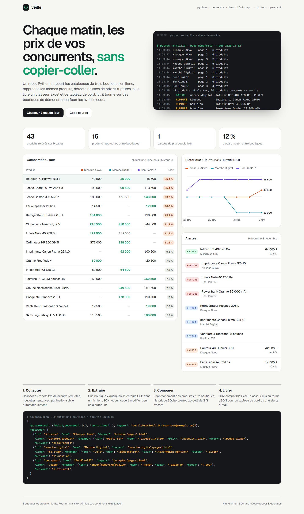
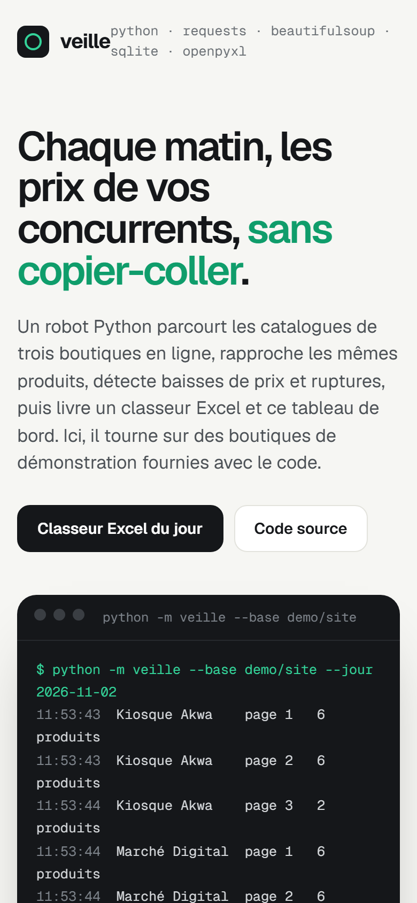

# Veille, robot de veille de prix

**Scraping et automatisation en Python** — Robot Python qui relève chaque jour les catalogues de boutiques concurrentes, rapproche les mêmes produits, garde un historique, signale baisses de prix et ruptures, et livre CSV, classeur Excel mis en forme et tableau de bord web. Livré avec trois boutiques de démonstration pour un test sans risque.

**Démo en ligne : [https://lordlennyx.github.io/veille-prix-python/](https://lordlennyx.github.io/veille-prix-python/)**

Spot de présentation (30 s) : [media/spot-30s.mp4](https://lordlennyx.github.io/veille-prix-python/media/spot-30s.mp4)

## Ce que le projet montre

- Collecte polie : robots.txt, délai entre requêtes, nouvelles tentatives avec attente croissante, pagination automatique
- Extraction déclarative : une boutique = des sélecteurs CSS dans sources.json (attributs, négation « épuisé »), aucune ligne de code à écrire
- Rapprochement des produits entre boutiques (normalisation des noms et unités), historique SQLite
- Alertes : baisse, hausse (seuil 3 %), rupture, retour en stock, nouveau produit, produit retiré
- Exports : CSV pour Excel FR, classeur XLSX (meilleur prix en vert, filtres, volets figés), JSON du tableau de bord
- Tests unitaires pytest ; planification possible par cron, Planificateur Windows ou GitHub Actions

## Réalisation

- **Stack :** Python 3.12, requests, BeautifulSoup, SQLite, openpyxl, pytest ; tableau de bord HTML/JS
- **Lancer la démo :** pip install requests beautifulsoup4 openpyxl && python demo/generer_site.py --jour 1 && python -m veille --base demo/site
- **Évolutions possibles :** Playwright pour les sites en JavaScript, proxies, alertes e-mail / Telegram, API

| Bureau | Mobile |
|---|---|
|  |  |

---

Client et contenus fictifs, créés pour la démonstration. Conception, design et développement : **Njundiyimun Béchard** — [github.com/LordLennyx](https://github.com/LordLennyx)
